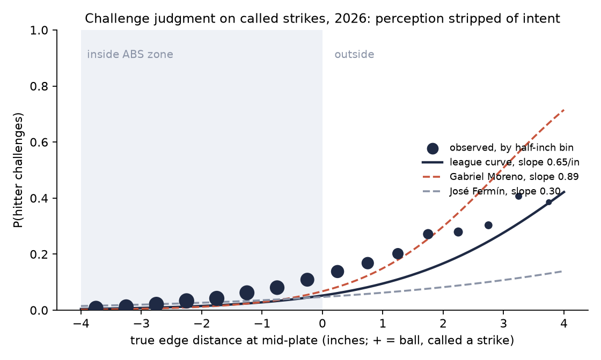
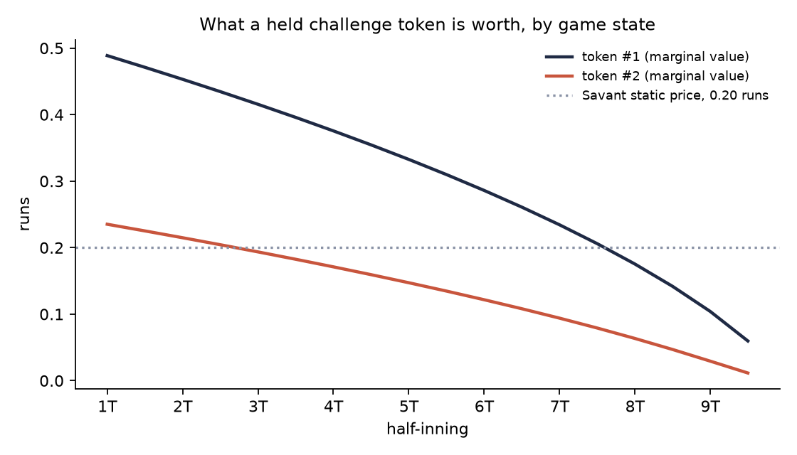
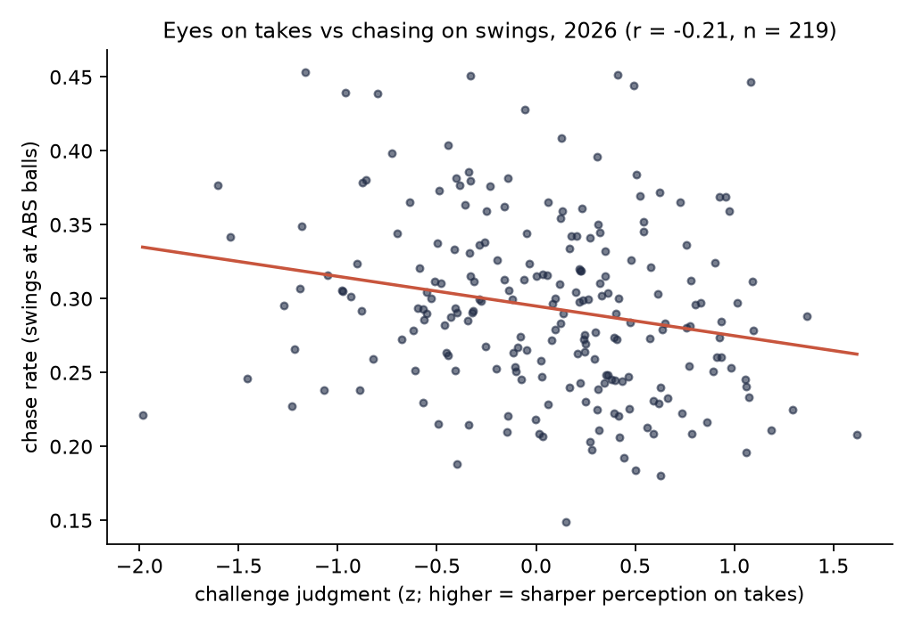

# ABS challenge judgment

A public measurement of a hitter's eyes, stripped of intent, built from the 2026 MLB Automated Ball-Strike challenge system. Two deliverables:

1. **A dynamic challenge policy.** The value of a held token priced by backward induction over the game, replacing Baseball Savant's constant 0.2-run price, with a per-player layer that turns each hitter's measured perception into a perceived-margin rule.
2. **The eyes-versus-approach test.** A hitter's chases are either a perception problem (pitch-recognition training) or an approach problem (a count plan). Challenge judgment on takes is the only public signal of perception with no swing in it. The test asks whether, among hitters with similar chase rates, poor location-adjusted challenge judgment predicts costlier chases, worse two-strike contact, and weaker year-over-year chase improvement. Judgment enters as a covariate pooled across hitters, so the per-hitter estimate need only be unbiased, not precise.

The decision link for the second is the hitting coordinator's development plan. The design is in [docs/research_design.md](docs/research_design.md). The data verification is in [docs/data_findings_2026-10-21.md](docs/data_findings_2026-10-21.md).

## What the data turned out to support

Everything below was verified against live endpoints on 2026-10-21.

- **Every ABS challenge is public at the pitch level.** The MLB StatsAPI live feed carries `reviewDetails` with review type `MJ`, the initiating player, and the outcome, on the pitch event for mid-plate-appearance challenges and on the play for PA-ending ones. The full 2026 regular season yields 10,557 challenges across 2,429 games, matching Savant's published total, and the per-team counts reconcile with the official in-game token ledger in all but one game.
- **The feed's strike-zone bounds are the ABS zone.** In 2026 `strikeZoneTop` and `strikeZoneBottom` are fixed per batter at 53.5% and 27% of measured height.
- **Mid-plate location is exact.** Extrapolating the feed's nine-parameter trajectory to the plate midpoint reproduces Savant's challenge coordinates to five decimals, and the resulting edge distance (ball edge to zone boundary, 2.9-inch ball) agrees with the ABS ruling on 99.99% of challenged pitches. This removes the front-of-plate caveat that public work had assumed.
- **The extra-innings rule, from the data.** 74 challenges were made by teams whose two regular tokens were gone, all in innings 10 to 13. The rule that explains every one is a top-up to one token at the start of each extra inning for a team at zero. The ledger's `remaining` counts only the regular tokens.
- **Savant's leaderboard exports CSV** (`?csv=true`) for batters, catchers, pitchers and teams, 2026 MLB and 2025 Triple-A. Its pitch-level table covers only the trailing seven days, so the season table comes from StatsAPI.

## Pipeline

```
scripts/01_pull_statsapi.py --season 2026 --sport 1   # 2,430 game feeds, cached gzip
scripts/02_pull_statcast.py --season 2026             # daily Statcast CSVs (run values, bat tracking)
scripts/02_pull_statcast.py --season 2025             # for year-over-year chase change
scripts/03_pull_savant_leaderboards.py                # Savant ABS leaderboards (reference)
scripts/04_build_pitch_table.py --season 2026         # pitch table + challenges + token state + geometry
scripts/05_judgment.py                                # per-hitter judgment scores
scripts/06_policy.py                                  # token value DP, static/dynamic/observed with SEs, seeds, sigma table
scripts/07_eyes_vs_approach.py                        # the test (rerun with --min-challenges 15 and 20)
scripts/09_figures.py                                 # README figures
scripts/10_reliability_checks.py                      # split-half reliability with intervals, by model, window and volume
scripts/11_club_brief.py                              # the club brief
```

Setup:

```bash
python3 -m venv .venv && .venv/bin/pip install -e ".[dev]" && .venv/bin/python -m pytest -q
```

Raw data lives in `data/raw/` (gitignored, about 2 GB), processed tables in `data/processed/`.

## Modules

| Module | What it does |
|---|---|
| `statsapi.py` | Schedule, cached feeds, extraction of pitches and challenges, chronological token-state reconstruction under three candidate extra-innings rules, ledger reconciliation |
| `zone.py` | Mid-plate trajectory solve, signed edge distance, ABS strike rule; tested against Savant's embedded challenge table |
| `savant.py` | Daily Statcast CSV pulls, ABS leaderboard CSV |
| `judgment.py` | Hierarchical logit of challenge on true edge distance, net of the side of the box the pitch missed on: random slope is perceptual sharpness, random intercept is the criterion; empirical-Bayes shrinkage under a full-covariance prior; direction likelihood-ratio tests; split-half reliability with intervals; signal-detection d-prime alongside |
| `policy.py` | Stake table from Statcast run values, calibrated and flat-prior beliefs, token value by backward induction with an extra-innings continuation, game-by-game policy simulation with paired standard errors |
| `chase.py` | Hitter-season chase and two-strike outcomes against the true ABS zone, plus a rulebook-zone chase rate for cross-season comparison |
| `models.py` | The pooled-covariate regressions with chase-rate quintile controls, stratified contrasts, hitter bootstrap, split-half reliability |

## The judgment model in one paragraph

Every umpire-called strike a hitter takes while the batting team holds a token (counting the extra-innings top-up) is a decision: challenge or not. The true location is known from the trajectory. Across a season a hitter faces 60 to 400 of these, from four inches inside the zone to six outside; the window is wider on the ball side because every batter challenge lies within six inches and those pitches are the only view of the top half of the curve (decision 20). A logit of challenge on true edge distance, with a per-hitter random intercept and slope, separates how sharply the hitter's challenge probability rises as the pitch moves from inside the zone to outside it (eyes) from how far off the plate a pitch must be before they spend a token (approach). Count, token state, leverage and the side of the box the pitch missed on (above, below, side, corner) shift the criterion and enter as fixed effects, so a hitter's criterion is net of his stimulus mix (decision 21). The per-hitter intercept and slope share a full 2×2 prior covariance, estimated by two-step empirical Bayes, and each hitter's posterior slope-intercept correlation is reported (decision 22).

## Results, 2026 regular season

All tables are in `data/processed/`; figures in `docs/figures/`. Sample: 2,429 games, 714,483 pitches, 10,557 challenges, Statcast joined on every pitch.

### The psychometric curve



Hitters faced 65,940 called strikes with a token in hand from four inches inside the zone edge to six outside and challenged 7.1% of them (95 of those pitches lie beyond four inches, and 39 of them were challenged). The umpire was wrong on 18% of those pitches. The league curve rises smoothly from under 1% at four inches inside the zone to about 40% at three and a half inches outside, and then stops rising: 41% of the pitches four to six inches outside were challenged, where the fitted logit says 62%. It is a curve, not a step: at the edge itself hitters challenge only 11 to 14% of true balls. Two strikes shift the criterion by 1.9 logits (strike three is worth challenging), three balls by 0.5, a second token in hand by 0.2, the seventh inning onward by 0.7.

**Direction.** At the same true distance hitters challenge a low called strike about twice as often as a high one (`judgment_curve_direction_mlb_2026.csv`):

| True edge, inches outside | Above | Below | Side | Corner |
|---|---|---|---|---|
| 0 to 1 | 9.5% | 21.4% | 13.5% | 22.2% |
| 1 to 2 | 17.6% | 29.2% | 20.7% | 34.8% |
| 2 to 4 | 28.0% | 41.3% | 26.7% | 33.3% |

Against the direction-blind pooled logit, direction intercepts add chi-square 360 on 3 df (above −0.28, below +0.54, corner +0.66 logits against a pitch off the side). Direction-by-distance slopes on top add 22 on 3 df (p = 0.00006), under the 33 that BIC charges for three parameters at 65,940 decisions, and the only sizeable one is the corner's (−0.28 per inch on 1,242 pitches); they are left out, and including them changes no reliability figure by more than 0.01 (decision 21).

| Quantity | Value |
|---|---|
| League slope | 0.63 per inch |
| Between-hitter SD of slope (eyes) | 0.18 |
| Between-hitter SD of intercept (criterion) | 0.67 |
| Prior correlation of intercept and slope across hitters | +0.28 (posterior means +0.39) |
| Posterior slope-intercept correlation within a hitter, median (10th to 90th percentile) | +0.20 (+0.08 to +0.30) |
| Hitters scored (60+ decisions) | 390 |
| Split-half reliability, full season: slope (300 hitters) | 0.27 [0.08, 0.42] |
| Split-half reliability, full season: criterion (300 hitters) | 0.78 [0.72, 0.82] |
| Split-half reliability, full season: d-prime (300 hitters) | 0.09 [0.00, 0.27] |

Brackets are 95% intervals (Fisher z on the split-half correlation, carried through the Spearman-Brown step-up). The headline measurement result is the last three rows. A hitter's willingness to challenge is a stable trait within one season. His accuracy is barely measurable per hitter: a typical hitter makes 10 to 25 challenges, and the slope's posterior SD (median 0.14) is most of the between-hitter spread (0.18). The slope correlates 0.77 with the simpler signal-detection d-prime. It correlates 0.39 with the criterion, up from 0.10 under the earlier diagonal prior: the full covariance lets the data say that hitters who challenge freely also tend to have steeper curves, and the shrinkage then pulls the two together. Within a hitter the slope and intercept posteriors correlate only +0.20 at the median, so the collinearity the review feared (B1) is not severe once the window reaches the ball side, but the curve's 50% point is still at 5.0 inches for the median hitter on a pitch off the side with no shifters (3.8 inches for the league at the average count and leverage), beyond four inches for 76% of hitters and beyond the window for 25%.

Split-half reliability by how often a hitter challenges (`scripts/10_reliability_checks.py`, hitters with the minimum in both halves, 95% Fisher-z intervals; the hitter bootstrap in the CSV agrees):

| Minimum challenges per half-season | Hitters | Slope reliability | Criterion reliability | Slope, earlier model (hitters) |
|---|---|---|---|---|
| none | 300 | 0.27 [0.08, 0.42] | 0.78 [0.72, 0.82] | 0.27 [0.08, 0.42] (300) |
| 3 | 190 | 0.30 [0.07, 0.48] | 0.75 [0.67, 0.81] | 0.34 [0.13, 0.51] (189) |
| 5 | 119 | 0.23 [0.00, 0.47] | 0.72 [0.60, 0.81] | 0.31 [0.01, 0.52] (119) |
| 8 | 60 | 0.28 [0.00, 0.57] | 0.67 [0.44, 0.80] | 0.48 [0.11, 0.69] (58) |
| 10 | 29 | 0.63 [0.21, 0.83] | 0.82 [0.61, 0.92] | 0.79 [0.54, 0.90] (28) |
| 12 | 20 | 0.65 [0.08, 0.86] | 0.81 [0.50, 0.93] | 0.74 [0.31, 0.90] (19) |

The earlier model is the one published before 2026-10-23: no direction, a diagonal prior, a ±4 inch window and the ledger's token count. Its 0.79 at ten challenges per half rested on 28 hitters and its interval runs from 0.54 to 0.90. Direction does not make the slope more reliable; if anything it is a little lower at every volume, because some of what looked like a stable eyes difference was a stable difference in which side of the box a hitter's called strikes miss on. Under the direction-aware model the lower end of the slope's interval does not reach 0.5 at any volume tested, so one season does not support a per-hitter eyes call for anyone (the brief no longer makes one, below). The window matters little on the ball side (−4 to +4: 0.63 [0.20, 0.83] at ten per half; −4 to +8: 0.63 [0.20, 0.83]) and a narrow ±2.5 window is worse (0.24 [0.00, 0.68]). In 2026, 64 regulars reached 20 challenges and 104 reached 15. Judgment is unidentified for hitters who rarely challenge; rankings and the main test use a minimum of eight, and the test is repeated at 15 and 20 below.

### Token value and the dynamic policy



Opportunities (taken pitches within three inches of the edge, both sides) arrive 1.34 times per team-half-inning played and the umpire misses 20% of them. The league judgment slope implies perceptual noise of about 2.7 inches (an upper bound, decision 9; 2.63 before the direction-aware refit, 2.71 after). A simulated challenger perceives the true edge plus that noise and believes the call will flip with the calibrated probability P(flip | perceived edge), a logit fit on the opportunities with the same noise draw (decision 17). That belief knows the umpire is right on four near-edge calls in five; in every quintile it is within 0.3 points of the true flip rate.

Pricing a token by backward induction, with extra innings as a continuation value (decision 18):

| State | First token | Second token |
|---|---|---|
| Start of game | 0.15 runs | 0.09 runs |
| Start of 5th | 0.11 | 0.07 |
| Start of 9th | 0.04 | 0.02 |
| Start of an extra inning (given the game is in one) | 0.04 | 0.02 |

At league-average eyes a token is worth less than Savant's flat 0.20 at every moment of the game, so Savant's breakeven rule is too stingy throughout, and more so late. The direction depends on the noise level (table below): with noise below about 1.8 inches the first token at first pitch is worth more than 0.20.

Playing every game forward with each rule, deciding on a perceived edge and scoring on the true ABS outcome (runs per team per 162 games; differences paired by game over 2,429 games, plus or minus one standard error; noise draw 0):

| Rule | Eyes | Challenges per team-game | Overturned | Runs per team per 162 | vs static | vs observed |
|---|---|---|---|---|---|---|
| Static (Savant breakeven) | simulated | 0.71 | 52.9% | 18.2 | | −14.7 ± 0.6 |
| Dynamic (this repo) | simulated | 2.80 | 40.2% | 37.8 | +19.6 ± 0.5 | +4.9 ± 0.7 |
| Observed behavior | real players | 2.04 | 54.1% | 32.9 | +14.7 ± 0.6 | |
| Oracle (perfect eyes) | perfect | 4.81 | 100% | 111.1 | +92.9 ± 0.8 | +78.2 ± 0.8 |

Across noise draws 0, 1 and 2, dynamic minus static is +19.6, +19.9 and +20.1 (SE 0.5 each) and dynamic minus observed +4.9, +5.2 and +5.8 (SE 0.7 each). These are at σ = 2.71 inches, from the direction-aware judgment refit; at the earlier 2.63 they were +19.2 and +5.5.

**The observed row is not the same eyes.** Static and dynamic share the simulated league-average Gaussian noise. Observed is real players with their own eyes, who overturned 54% of 2.04 challenges a game. The noise model cannot produce that: under calibrated beliefs only 2,085 of 115,389 opportunities carry p above 0.6, yet players won 5,352 challenges. Real players hold information the noise model lacks, so the gap between either simulated rule and observed is not a property of the rule. The comparison the model supports is static against dynamic.

The dynamic rule is worth about 20 runs per team-season over Savant's static rule with the same simulated eyes, because the static rule's 0.20 price makes a league-average challenger wait for a 51% chance on a typical pitch, which that challenger rarely has, so it challenges 0.71 times a game. The gap between any rule and the oracle is the value of perception, which is where the per-player layer lives: `policy_hitter_thresholds_mlb_2026.csv` states, for each hitter, how far off the plate a pitch must look before spending the last token at the median stake. Sharpest hitters need about 2.3 inches in the first inning; the median hitter 4.9; for 27% of rated hitters the margin is beyond six inches, which in practice means not to spend the last token early on a median-stakes pitch. In the ninth the median is 1.2 inches. These margins rest on a slope whose split-half reliability is 0.28 [0.00, 0.57] at eight challenges per half and should be read to the nearest inch.

**What changed on 2026-10-23.** The first version used the flat-prior belief Φ(perceived edge / σ), which ignores how often the umpire is right; a simulated p of 0.8 to 1.0 flipped 49% of the time. `scripts/06_policy.py --flat-prior` reproduces it (to `*_flatprior` files), and every run prints both:

| Belief | First token, first pitch | Static: chal / overturned / runs | Dynamic: chal / overturned / runs | Dynamic − static | Dynamic − observed |
|---|---|---|---|---|---|
| Calibrated (current) | 0.147 | 0.71 / 52.9% / 18.2 | 2.80 / 40.2% / 37.8 | +19.6 ± 0.5 | +4.9 ± 0.7 |
| Flat prior (before) | 0.493 | 3.09 / 38.9% / 32.0 | 3.22 / 40.0% / 34.7 | +2.7 ± 0.3 | +1.8 ± 0.7 |

Both rows are at σ = 2.71 inches. The previously published flat-prior figures (0.487, +2.65, +2.34) differ from the second row because the DP now models extra innings, the arrival rate is per half-inning played rather than per scheduled half-inning, and σ comes from the direction-aware judgment fit. The advice reverses: the old table said to be stingy early and aggressive late; with coherent beliefs a token is worth less than Savant's price all game.

**Sensitivity to the noise level** (noise draw 0; `policy_sigma_mlb_2026.csv`):

| Noise σ (in) | Calibrated: first token | Static runs | Dynamic runs | Dynamic − static | Flat prior: first token | Dynamic − static |
|---|---|---|---|---|---|---|
| 1.0 | 0.318 | 60.9 | 69.8 | +9.0 ± 0.4 | 0.458 | +2.2 ± 0.4 |
| 1.5 | 0.232 | 41.4 | 55.0 | +13.6 ± 0.5 | 0.457 | +1.9 ± 0.4 |
| 2.0 | 0.183 | 28.5 | 45.4 | +16.9 ± 0.5 | 0.470 | +2.7 ± 0.4 |
| 2.71 (league) | 0.147 | 18.2 | 37.8 | +19.6 ± 0.5 | 0.493 | +2.7 ± 0.3 |
| 3.5 | 0.128 | 12.0 | 33.6 | +21.6 ± 0.6 | 0.514 | +3.0 ± 0.3 |
| 4.5 | 0.115 | 8.6 | 31.2 | +22.5 ± 0.6 | 0.535 | +2.4 ± 0.3 |

Under the flat prior the conclusion was insensitive to σ and entirely driven by the belief model. Under calibrated beliefs σ matters: the sharper the eyes, the more a token is worth and the smaller the gain from dynamic pricing, because Savant's 0.20 is then close to right early in the game.

### The eyes-versus-approach test



Sample: 221 hitters with 60+ decisions, 8+ challenges and 150+ PA. Every number in this section is from the direction-aware score; the before-and-after record is at the end of the section.

**Judgment predicts chasing.** Sharper challenge judgment correlates −0.18 with chase rate (p = 0.006; −0.35 after correcting for the score's reliability of 0.27, though with that reliability's interval the correction runs from −0.28 to −0.63). It also correlates +0.23 with walk rate and −0.17 with in-zone swing rate, and −0.04 with strikeout rate. The criterion correlates +0.17 with chase rate (hitters who spend tokens freely also swing freely) and not with walks. So the perception signal on takes is related to swing decisions in the expected direction, and the aggressiveness signal is a different thing.

**Holding chase rate fixed, judgment predicts nothing else yet.** With chase-rate quintile, criterion, bat speed and bat side controlled, a one-SD increase in judgment moves:

| Outcome | Effect per SD of judgment | Robust SE | p | Effect in outcome SDs, disattenuated |
|---|---|---|---|---|
| Runs per 100 chase swings | −0.19 | 0.18 | 0.30 | −0.38 |
| Whiff rate on chases | −0.002 | 0.010 | 0.81 | −0.08 |
| xwOBA on chase contact | −0.003 | 0.005 | 0.60 | −0.22 |
| Two-strike contact rate | +0.004 | 0.006 | 0.45 | +0.25 |
| Strikeout rate | −0.005 | 0.006 | 0.39 | −0.30 |
| Two-strike chase rate | +0.007 | 0.005 | 0.20 | +0.33 |

None is distinguishable from zero, and the within-quintile contrasts change sign across quintiles. The one with a nonzero point estimate, run value per chase, points the wrong way for the hypothesis (sharper eyes, costlier chases), and its disattenuated size is still within noise.

**Restricting to frequent challengers, where the score is less noisy.** With 15 or more challenges (104 hitters), the judgment-chase correlation strengthens to −0.30 and the criterion-chase correlation to +0.24, as better measurement should produce (at 20+, 64 hitters, −0.25). The conditional effects stay null:

| Outcome (15+ challenges, n = 104) | Effect per SD of judgment | Robust SE | p |
|---|---|---|---|
| Runs per 100 chase swings | −0.32 | 0.28 | 0.25 |
| Whiff rate on chases | +0.008 | 0.014 | 0.56 |
| xwOBA on chase contact | −0.007 | 0.007 | 0.34 |
| Two-strike contact rate | +0.000 | 0.009 | 0.99 |
| Strikeout rate | +0.004 | 0.009 | 0.70 |
| Two-strike chase rate | +0.002 | 0.008 | 0.83 |
| Year-over-year chase change (2025 to 2026, n = 89) | −0.002 | 0.006 | 0.73 |

**Year-over-year chase change is the one positive result, with a caveat.** The row above controls for the 2026 chase rate, which is the endpoint of the change and biases that row toward zero (p = 0.06 on 175 hitters with a 2025 season at 8+ challenges). The clean question is: among hitters with the same 2025 chase rate, do sharper eyes go with a lower 2026 chase rate?

| Sample | n | 2026 chase rate per SD of judgment, holding 2025 chase rate | Robust SE | p |
|---|---|---|---|---|
| 8+ challenges | 175 | −0.0114 | 0.0042 | 0.007 |
| 15+ challenges | 89 | −0.0081 | 0.0058 | 0.16 |
| 20+ challenges | 56 | −0.0086 | 0.0076 | 0.26 |

One SD of sharper judgment goes with about one percentage point less chasing than the hitter's 2025 rate predicts, against a year-over-year change SD of 3.5 points. The point estimate is stable across thresholds; only the full sample has the power to call it, and the full sample is where the score is least reliable. It is also one of 27 tests (nine outcomes at three thresholds); a Bonferroni bar would be p < 0.002. Two caveats. Judgment and the 2026 chase rate are measured in the same season, so a common cause (a hitter who simply saw the ball better in 2026) is not excluded; the pre-registered version uses 2026 judgment to predict the 2027 change. And the rulebook chase rate rose league-wide from 28.4% to 30.6% because the 2026 zone bounds in the Statcast feed are the fixed ABS bounds rather than stance-based; the shift is absorbed by the intercept but the levels are not comparable across years.

Every chase-quality point estimate leans the wrong way (sharper eyes, slightly costlier chases), so one candidate explanation was tested: that sharper hitters lay off borderline balls and their remaining chases are further off the plate, which are costlier league-wide (−0.04 runs per chase within an inch of the zone, −0.09 beyond six inches). It fails. Holding chase rate fixed, judgment does not move a hitter's mean chase edge distance or the share of far chases (p = 0.36 and 0.19 at 8+ challenges, 0.89 and 0.93 at 15+). The leanings are unexplained noise.

**Reading.** Among hitters who chase the same amount, the ones with sharper challenge judgment do not chase more cheaply, make more two-strike contact, or strike out less. What judgment does predict is the chase rate itself, both in cross-section (−0.18 overall, −0.30 among frequent challengers) and as a change from the prior season (about one point lower per SD, holding the 2025 rate). The eyes-versus-approach split as measured here says *whether* a hitter chases, and in which direction they are moving, not *what happens* when they swing at a ball. The interpretation that fits is that perception on takes near the edge governs the decision to swing, while the outcome of a swing at a ball is governed by something else (bat-to-ball skill, pitch type, how far off the plate the chase is). For the hitting coordinator this means the score, pooled across hitters, says something about the *rate* problem; it does not identify who will pay most per chase, and one season does not support calling any single hitter an eyes case or an approach case (the reliability table above). The nulls on frequent challengers rest on a score whose reliability is still uncertain (0.63 [0.21, 0.83] at ten challenges per half) and 104 hitters cannot rule out small effects; 2027 doubles the sample, and the pre-registered test is 2026 judgment against 2027 chase change.

**Before and after the direction-aware refit (2026-10-23).** Same hitters, same outcomes, same regressions; only the judgment score changed (direction intercepts, the −4 to +6 window, the extras top-up in the token count, a full-covariance prior):

| | Before | After |
|---|---|---|
| Judgment-chase correlation, 8+ challenges | −0.211 (n = 219) | −0.183 (n = 221) |
| Judgment-chase correlation, 15+ | −0.311 (102) | −0.295 (104) |
| Judgment-chase correlation, 20+ | −0.283 (62) | −0.254 (64) |
| 2026 chase rate per SD, holding 2025, 8+ | −0.0099 ± 0.0040, p = 0.013 (175) | −0.0114 ± 0.0042, p = 0.007 (175) |
| Same, 15+ | −0.0070 ± 0.0056, p = 0.22 (88) | −0.0081 ± 0.0058, p = 0.16 (89) |
| Same, 20+ | −0.0090 ± 0.0072, p = 0.21 (54) | −0.0086 ± 0.0076, p = 0.26 (56) |
| Slope reliability, no minimum | 0.27 [0.08, 0.42] (300) | 0.27 [0.08, 0.42] (300) |
| Slope reliability, 10+ per half | 0.79 [0.54, 0.90] (28) | 0.63 [0.21, 0.83] (29) |
| Criterion reliability, no minimum | 0.78 [0.72, 0.82] (300) | 0.78 [0.72, 0.82] (300) |
| Hitters labelled Eyes case or Approach case in the brief | 66 | 0 |

The ± figures are robust standard errors. The 2025-to-2026 result survives and is a little stronger; the cross-sectional correlations weaken slightly, as they should if part of the old score was direction mix.

### Validation

- Per-player challenge attribution matches Savant's leaderboard: batters 99.4% exact (the only gap is two players named Max Muncy merged by name), catchers 100% within one, pitchers 100% exact.
- Geometry agrees with the ABS ruling on 99.99% of challenged pitches, with zero disagreements within a quarter inch.
- End-of-game token state matches the official ledger in 99.84% of games under the ledger's accounting; the per-inning extras top-up explains all 74 zero-token challenges.

## Club brief

`scripts/11_club_brief.py` turns the processed tables into a single self-contained page for coaches and front offices, in `report/`:

- `club_brief_2026.html` is the web version (publish it as a shareable page).
- `club_brief_2026_standalone.html` opens locally and can be attached to an email.

Part one is for the dugout: when to spend a token (thresholds by inning, tokens held and stake, in percent and in inches for an average eye), per-hitter challenge cards with a team selector (challenges, overturns, the eyes score as a percentile range of plus or minus one posterior SD, the criterion percentile, and the perceived margin each hitter should want before challenging early, mid-game and in the ninth), and the eyes-versus-approach sort. The sort assigns "Eyes case" and "Approach case" only from the challenge count at which the slope's reliability clears 0.5 at the lower end of its interval (`reliability_checks_mlb_2026.csv`); in 2026 no volume does, so no hitter gets either label, and high-chase hitters are sorted on the criterion instead ("free with tokens" or "sparing with tokens"). Part two is the evidence: the psychometric curve, reliability by challenge volume, the policy simulation with paired standard errors and noise draws, the belief-model comparison and the σ table, the test results, and methods. The brief generator refuses to write a page that shows nan, None or undefined outside script code. Every table names the processed file it came from, so the page regenerates on a new season with `scripts/run_pipeline.sh` followed by this script.

### What a club can act on now

Part one of the brief opens with facts that need no model, counted from the feeds with every pitch's true location (`first_actions` in `scripts/11_club_brief.py`). "Runs left" prices each unchallenged umpire miss at its stake: an upper bound, since no one can see every miss, but the same yardstick for every team.

- Batters challenged 19% of the 11,992 true balls called strikes while they held a token, leaving about 40 runs per team-season; catchers challenged 32% of 10,444 true strikes called balls, leaving 32. Teams ranged from 12% to 26% of their hitters' misses challenged.
- The high strike is the one to challenge. Umpires call strikes on 49% of takes in the first inch above the ABS box, against 40% off the side and 40% below it, and hitters challenge only 15% of high misses against 26% of low ones. The box's top sits below the zone umpires call.
- Strike three on a true ball went unchallenged 0.14 times per team-game with a token in hand (688 in the season, 7.3 runs per team-season).
- Of the 2,438 batter challenges that lost, the median was 1.2 inches inside the zone, and 36% were low pitches against 25% of all decisions: hitters over-challenge low and under-challenge high.
- Hitters challenged 15% of misses in the first inch outside the box, 23% in the second and 31% beyond, leaving 25, 11 and 4 runs per team-season; the second inch is where knowing the box pays most.

The token-value guidance that follows it rests on the calibrated belief model and a noise level that is an upper bound (see the sensitivity table), so a club should act on the facts above first and read the thresholds as the direction of the correction, not its size.

## Limits

- One season of ABS. Year-over-year stability of the judgment score cannot be measured until 2027; split-half reliability within 2026 is reported instead.
- Judgment is measured on takes near the edge and may not transfer to pitches hitters chase, which are often further off the plate. That is the test, not an assumption.
- The 2025 Triple-A feed has the same challenge structure but omits the initiating player.
- The Statcast join covers Statcast-equipped parks only; the feed geometry covers every pitch.
- The policy simulation gives every challenger league-average Gaussian eyes. Real players do better than that model on the challenges they make (54% overturned), so the observed row is context, not a comparison of rules.
- Under calibrated beliefs the token's value depends on the noise level σ, and σ = 1.7 / slope is an upper bound. If the true league noise is below about 1.8 inches, the first token early is worth more than Savant's 0.20 and the early-game advice moves back toward Savant's rule.
- The DP prices the token at the start of each half-inning, plays all 18 half-innings in every game, and treats run stakes as independent of the score. Run units, not win probability.
- Per-hitter margins use each hitter's own σ from a slope with reliability near 0.3 at eight challenges; they are mostly the prior for infrequent challengers.
- The per-hitter eyes score does not reach a reliability of 0.5 at the low end of its interval at any volume one season gives, under the direction-aware model. It is useful pooled across hitters (the test) and as a range per hitter, not as a per-hitter label.
- The challenge rate stops rising beyond about three and a half inches outside (41% at four to six inches against 62% from the logit). A psychometric function with an upper asymptote fits the pooled data better (log-likelihood up by 46 for one parameter, ceiling about 0.63); the slope is still a logistic slope and partly reflects that ceiling. Hitters let a third or more of obvious misses go for reasons other than perception (game state, the last token), which a per-hitter lapse rate would model.
- Direction enters as intercept shifts only. The direction-by-distance slopes are significant (chi-square 22 on 3 df) but do not pay their BIC price; the corner's is the only sizeable one.
- The invisible ABS box sits inside the umpire's traditional zone, especially at the top, so a hitter deciding on a high strike is partly deciding where the box is. The above intercept absorbs the league-wide part of that; a hitter-specific calibration error about the top of the box would still look like shallower eyes.
- Split-half reliability compares a learning period (challenge rates on true balls rose from March to June) with a settled one, and requiring a minimum in both halves selects on stability, so the reliability figures carry more uncertainty than their intervals show.
